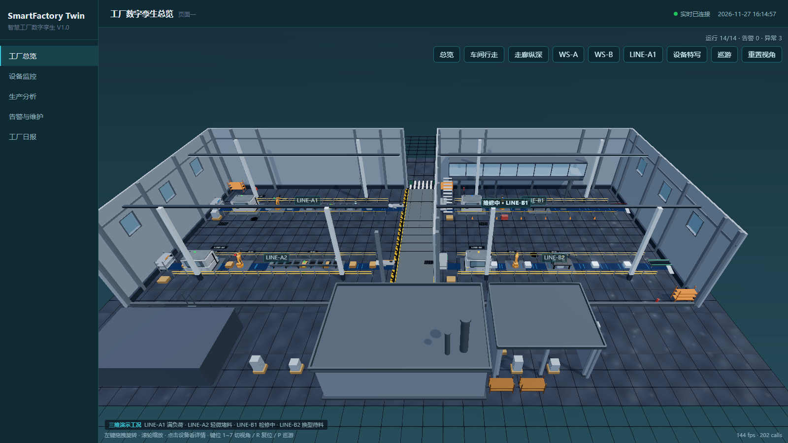
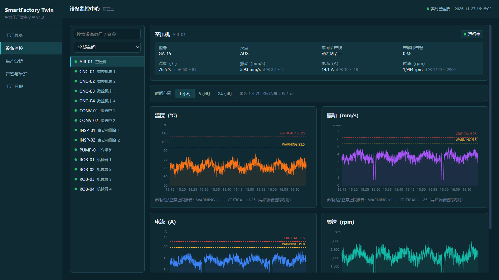
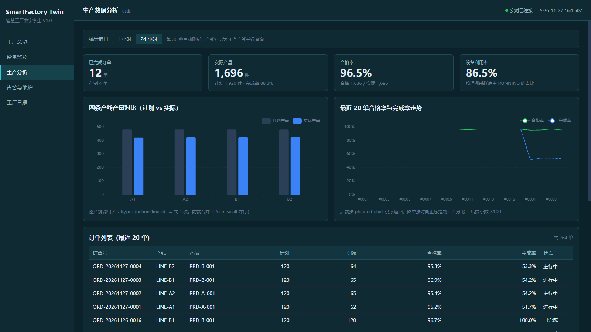
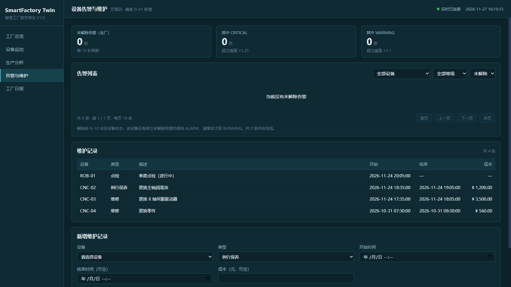
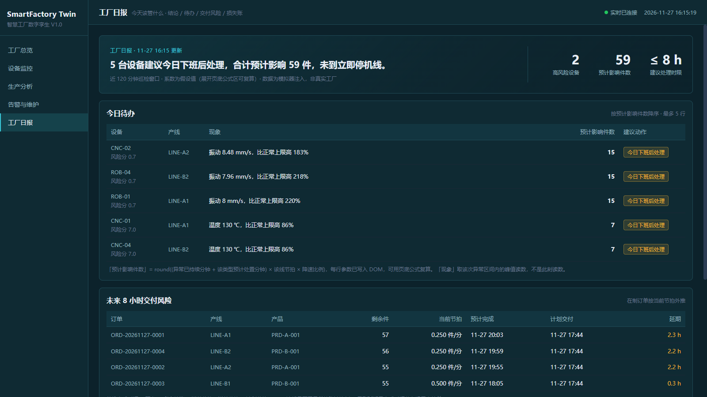

# SmartFactory Twin —— 智慧工厂数字孪生与 AI 智能分析平台

[](LICENSE)
[](https://www.python.org/)
[](https://react.dev/)
[](https://www.timescale.com/)

以虚拟机械加工工厂为场景的数字孪生演示系统：**1 工厂 / 2 车间 / 4 生产线 / 14 台设备**，
数据由模拟器持续生成，三维场景随设备状态实时运行，AI 异常检测模型对遥测流在线推理。

> **数据性质声明**：本项目全部数据为**模拟数据**，用于毕业设计与技术演示；
> AI 输出为辅助参考，三维模型做了工程化简化。不得对外表述为真实工厂数据。

## 页面总览

| 三维总览 `/overview` | 设备监控 `/devices` |
|---|---|
|  |  |

| 生产分析 `/production` | 告警与维护 `/alerts` |
|---|---|
|  |  |

| 工厂日报 `/ai` |
|---|
|  |

**五个页面**：

- **工厂总览**（纯三维展示页）：车间室内化的三维工厂，14 台设备随模拟器状态实时运行——
  物料沿产线流动、停机时在上游排队、滚筒转动、机械臂摆动、状态灯与告警描边可辨；
  7 个镜头预设（总览 / 车间行走 / 走廊纵深 / WS-A / WS-B / LINE-A1 / 设备特写）平滑切换，
  14/14 设备点击命中，自动巡游；页面状态栏实时显示 fps 与 draw call；
- **设备监控**：14 台设备四指标（温度 / 振动 / 电流 / 转速）实时曲线，带 WARNING / CRITICAL
  参考线，1h / 6h / 24h 切换；
- **生产数据分析**：四条产线计划 vs 实际产量对比、合格率与完成率趋势、订单列表；
- **告警与维护**：未解除告警 KPI、告警列表（每页 10 条 + 翻页）、维护记录登记；
- **工厂日报**（AI 页）：上层是异常检测模型输出（状态条 / 四指标卡 / 混淆矩阵 / 四模型对比 /
  分数曲线），下层是今日拾份与未来 8 小时交付风险。
  **页面上每个数字都能追到 `/ml/*` 的一次真实返回**，模型缺失时整栏切降级态，不显示占位数字。

## 技术栈与架构

```
data_pipeline（模拟器）──HTTP 批量写入──▶ FastAPI（app/）──▶ PostgreSQL + TimescaleDB（Docker）
   │ 三类异常注入 + ground truth            │ 告警扫描/收敛（G-10）              ▲
   └── 订单推进 / 历史回填                  │ WebSocket 快照推送                 │
                                            ▼                                    │ 遥测写入
frontend（React 18 + TS + Three.js + ECharts）──── /api 代理 + WS 直连 ─────────┘
                                            │
ml/（离线训练：sklearn + XGBoost）──► 模型 artifact ──► 后端 ml_anomaly.py 实时推理 ──► /ml/*
```

| 层 | 技术 | 说明 |
|---|---|---|
| 前端 | React 18 · TypeScript 5.6 · Vite 6 · three 0.170 · ECharts 5.5 | 三维程序化建模 + 后处理管线（ACES / Bloom / SMAA） |
| 后端 | FastAPI · SQLAlchemy · Uvicorn | 18 组 REST 接口 + WebSocket 推送（接口文档 `/docs`） |
| 数据库 | TimescaleDB 2.17.2（PostgreSQL 16） | `device_telemetry` hypertable + 压缩 |
| AI | scikit-learn · XGBoost | 异常检测二分类 + 三分类归因，离线训练 / 在线推理 |
| 测试 | pytest（25 用例）· Vitest（195 用例）· CDP 验收脚本 ×8 | 见 [测试](#测试) |

## 核心实测指标

数字均可在对应验收文档中复跑溯源，不是口头声称：

| 项 | 实测值 | 来源 |
|---|---|---|
| 异常检测主模型（XGBoost） | PR-AUC **0.9859** / Recall **0.9830** / Precision **0.9063**（78 维特征，84.8 万行训练集） | `docs/acceptance_phase4.md` §4.1 |
| 对比阈值规则基线 | PR-AUC 0.9098 / Recall 0.8028 | 同上 |
| TimescaleDB 迁移一致性 | 4,570,704 行迁移前后完全一致 | 同上 §4.3 |
| 压缩收益 | 遥测表 1,001 MB → **234 MB**（总量 3.97:1）；扫描类查询提速 31%~47% | 同上 §4.4 |
| 三维交互 | 14/14 设备点击命中、7 预设镜头 ≤1.2 s 平滑过渡 | `docs/acceptance_phase4_d.md` |
| 产线动画 | 物料流动 / 排队 / 滚筒 / 机械臂 17 项断言全过 | `docs/acceptance_phase3.md` 第 3 批 |

## 快速开始

环境要求：**Docker**、**Python 3.11+**（3.13 实测通过）、**Node.js 18+**。Windows / PowerShell。

### 一键启动（推荐）

```powershell
powershell -ExecutionPolicy Bypass -File scripts\start-all.ps1
```

按顺序做四件事（数据库 → 后端 → 模拟器 → 前端），任一步失败即停；三个服务窗口保持打开。
成功后打开 <http://127.0.0.1:5173/overview>（用 `127.0.0.1`，`localhost` 会因 IPv6 解析白等约 2 秒）。

### 分步启动

```powershell
# 1. 数据库（TimescaleDB 2.17.2 / PG16，宿主机端口 5433，避免占用本机 5432）
docker compose up -d
docker exec sftwin-db pg_isready -U sf -d smartfactory

# 2. Python 依赖
python -m venv .venv
.\.venv\Scripts\Activate.ps1
pip install -r requirements.txt          # 只跑系统不需要 AI 依赖
# pip install -r requirements-ml.txt     # 训练/重评模型才需要（xgboost 约 200 MB）

# 3. 建表与种子数据（10 表 / 15 索引；2 车间 / 4 产线 / 14 设备）
Get-Content database\schema.sql | docker exec -i sftwin-db psql -U sf -d smartfactory
Get-Content database\seed.sql   | docker exec -i sftwin-db psql -U sf -d smartfactory

# 4. 后端（接口文档 http://localhost:8000/docs）
uvicorn app.main:app --port 8000

# 5. 模拟器（另开窗口）
python -m data_pipeline.simulator                                # 常驻
python -m data_pipeline.simulator --backfill-days 1 --duration 30 # 先补 1 天历史再跑 30 秒

# 6. 前端（另开窗口）
cd frontend
npm install
npm run dev
```

> **⚠️ `database/reset.sql` 会清空全部 10 张表的所有数据（不可恢复）**，只在从零重来时执行；
> 日常建表用 `schema.sql`（只建不删，可重复执行）。

> REST 走 Vite 的 `/api` 代理（后端无 CORS 中间件），WebSocket 直连 `ws://127.0.0.1:8000`。

### AI 模型（可选）

模型 artifact 体积大不进 git，克隆后 AI 页会显示降级态并写明原因。要启用：

```powershell
pip install -r requirements-ml.txt
# 训练流程见 docs/spec_phase4.md 4.1；训练产物输出到 artifacts/
```

## 测试

```powershell
# 后端接口测试（25 用例）—— ⚠️ 先停掉 uvicorn，两进程抢写告警表会让冷却用例随机失败
pytest

# 前端单测（195 用例 / 18 文件）
cd frontend && npm run test

# 页面级验收（CDP 驱动无头浏览器真点击；前提：Chrome --remote-debugging-port=9222，前端 5173，后端 8000）
node scripts/acceptance-batch2.mjs   # 页面级 24 项
node scripts/acceptance-motion.mjs   # 产线运行动画 17 项
node scripts/acceptance-ai.mjs       # AI 页 42 项（指标可追溯 / 降级态 / 无控制台异常）
node scripts/acceptance-device.mjs   # 设备建模 v2 54 项
node scripts/capture-pages.mjs       # 五页截图 → docs/img/（README 用的图就是它拍的）
```

## 目录结构

```
app/                     FastAPI 后端（routers/ 接口，services/ 告警扫描收敛 + ML 在线推理）
data_pipeline/           数据模拟器（指标生成 / 异常注入 / 订单推进 / 历史回填）
database/                schema.sql（只建不删）/ seed.sql / reset.sql（⚠️ 清库）/ TimescaleDB 迁移
config/devices.json      14 台设备清单 + 正常区间 + 告警阈值（唯一配置来源，无魔法数字）
frontend/                React + Three.js + ECharts 前端
  src/three/             三维场景（布局 / 程序化建模 / 后处理 / 产线动画 / 镜头与拾取）
  src/pages/             五个页面
  src/charts/            ECharts 配置（混淆矩阵热力图 / 四模型对比 / 分数曲线）
ml/                      AI 模型（78 维特征抽取 + 训练 / 评估 / 登记）
scripts/                 一键启动 + 8 个 CDP 验收脚本 + 页面截图工具
tests/                   pytest 接口测试（25 用例）
docs/                    规格与验收文档（见下）
artifacts/               模型产物（体积大不进 git，由 ml/ 脚本重建）
```

## 文档

| 文档 | 内容 |
|---|---|
| [`docs/方案.md`](docs/方案.md) | 实验方案 V1.0：定位、架构、数据模型、路线与验收标准 |
| [`docs/项目介绍.md`](docs/项目介绍.md) | 面向读者的项目介绍（功能、亮点、指标、边界） |
| `docs/spec_phase2.md` / `spec_phase3.md` / `spec_phase4.md` | 各阶段实现规格（冻结后为施工唯一依据） |
| `docs/acceptance_phase2/3/4.md`、`acceptance_phase4_d.md` | 各批次验收记录（命令 + 实际输出 + 实测数字） |
| [`PROGRESS.md`](PROGRESS.md) | 交接与进度页：做过什么 / 验证到什么程度 / 下一步 |
| `AGENTS.md` | 多 agent 协作规则（文档驱动、规格先行、提交纪律） |

## License

[MIT](LICENSE)
